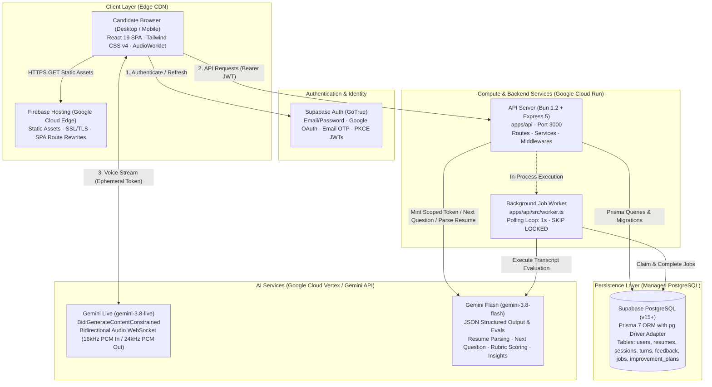
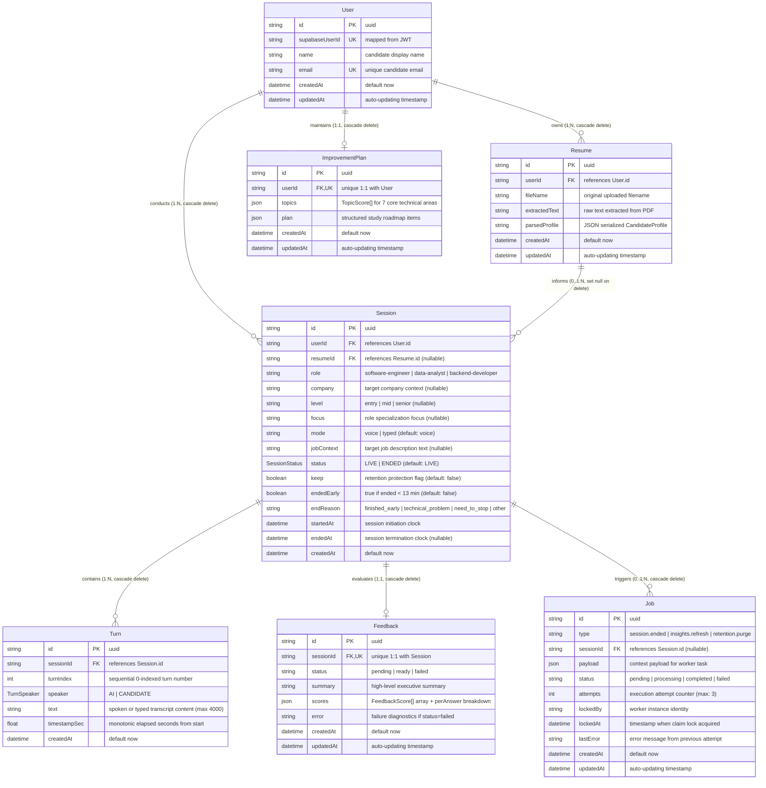
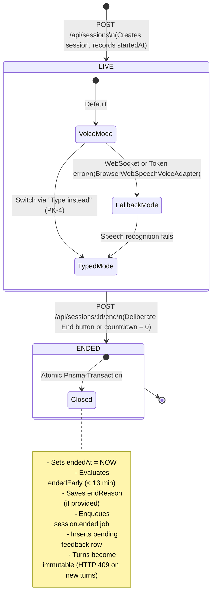
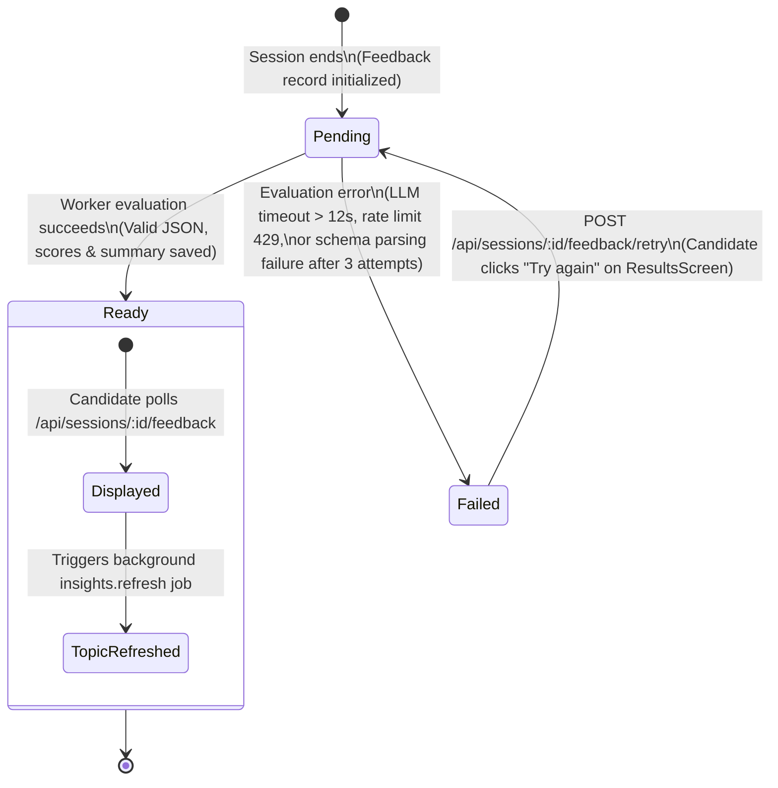
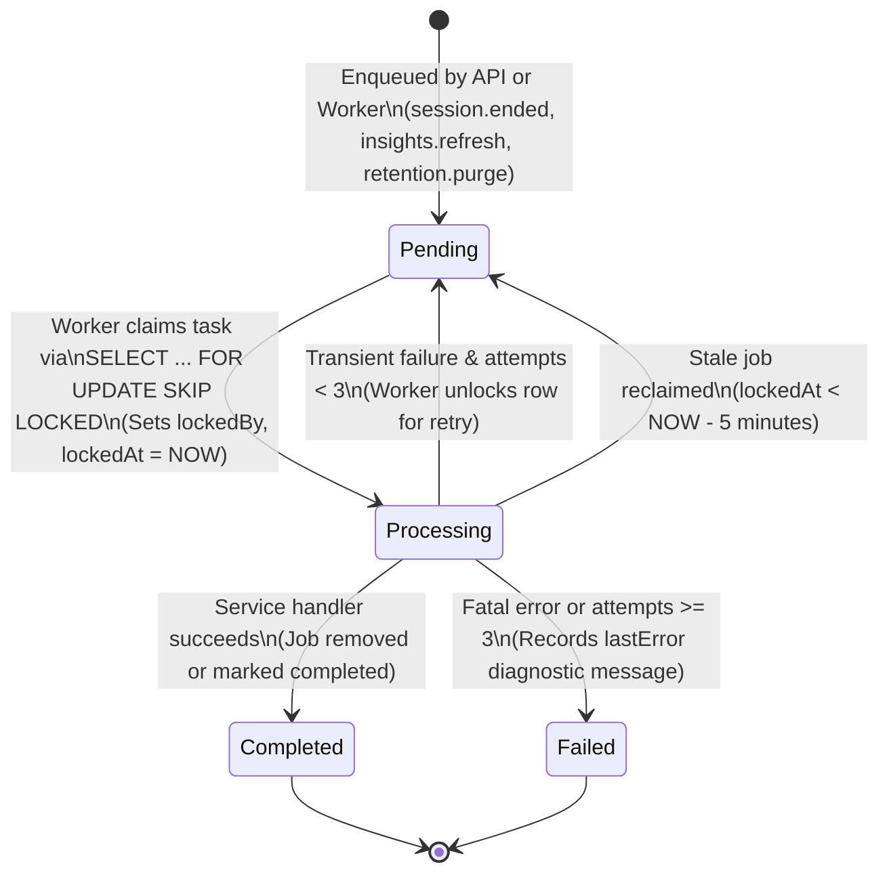

# Architecture & Design Document (D-1)

> **Document ID:** D-1 (Issue [#202](https://github.com/prayag-kachhia/AI-Interviewer/issues/202))  
> **Author:** Kishan Savani (@kishan-savani-ops)  
> **Reviewer:** Vishwa Mohan (@vishwa-mohan), Prayag Kachhia (@prayag-kachhia)  
> **Status:** Accepted & Frozen (Sprint 5)  
> **Supersedes:** Sections 2 and 5 of [`docs/codebase-guide.md`](codebase-guide.md) (marked as archived).

---

## 1. Executive Summary & Design Principles

The **AI Interviewer** platform provides realistic, spoken technical mock interviews with personalized LLM evaluation for software engineering and data candidates. Designed as an automated practice system, candidates sign in, configure target interview parameters (role, seniority level, technical focus, company culture, job description, and uploaded resume), hold an interactive voice or typed mock interview, and receive structured rubric feedback.

```
                          ┌────────────────────────┐
                          │   Candidate Browser    │
                          │ (React 19 + Vite SPA)  │
                          └───────────┬────────────┘
                                      │
              ┌───────────────────────┼───────────────────────┐
              │ Sign-in (JWT)         │ REST API (Bearer)     │ Bidirectional Voice
              ▼                       ▼                       ▼
    ┌──────────────────┐    ┌──────────────────┐    ┌──────────────────┐
    │  Supabase Auth   │    │  Cloud Run API   │    │   Gemini Live    │
    │  (Identity/MFA)  │    │  (Bun + Express) │    │ (WebSocket Bidi) │
    └──────────────────┘    └─────────┬────────┘    └──────────────────┘
                                      │
                         ┌────────────┴────────────┐
                         ▼                         ▼
               ┌──────────────────┐      ┌──────────────────┐
               │ Supabase Postgres│      │  Gemini 3.8 LLM  │
               │ (Prisma 7 DB)    │      │ (Flash Services) │
               └──────────────────┘      └──────────────────┘
```

The system is engineered around four core architectural principles:

1. **Strict Credential Isolation (NFR-09):** The browser client never touches backend API keys (`GEMINI_API_KEY`, `SUPABASE_SERVICE_ROLE_KEY`). Real-time speech uses ephemeral, single-use tokens minted server-side with locked system instructions.
2. **Unified Interviewer Brain (`briefingFor`):** Every interaction mode (Gemini Live bidirectional voice, Web Speech fallback, and typed mode) shares identical server-side instructions, 3-phase question progression, guardrails, and non-repetition guarantees.
3. **Transactional Background Processing (NFR-03, NFR-04):** Long-running evaluation tasks execute via a PostgreSQL-backed job queue with `SELECT ... FOR UPDATE SKIP LOCKED`, isolating LLM inference from synchronous HTTP request cycles and guaranteeing zero lost transcripts on container restarts.
4. **Contract-Driven Type Safety:** Shared Zod schemas in `packages/contracts` establish a single source of truth across the full stack, preventing client/server serialization drift.

---

## 2. Deployment Architecture

The application is deployed across managed Google Cloud and Supabase cloud infrastructure:



### Component Roles & Boundaries

| Component | Technology | Responsibility |
|---|---|---|
| **Web Frontend** | React 19, Vite, Tailwind CSS v4, Lucide | Responsive candidate interface; AudioWorklet microphone capture; Gemini Live audio streaming; results charts. |
| **Edge Hosting** | Firebase Hosting | Global CDN distribution of pre-compiled Vite static bundle (`dist/`); gzip/brotli compression; client-side route rewrites. |
| **Auth Provider** | Supabase Auth | Identity management, password salting/hashing, email OTP verification, OAuth flows; issues signed ES256/HS256 JWT tokens. |
| **API Backend** | Express 5 on Bun Runtime | Authenticated REST endpoints, session state management, input validation via Zod, briefing generation, job orchestration. |
| **Database** | PostgreSQL on Supabase | ACID relational persistence, foreign key cascading, unique constraints on turn ordering, row-level locking via `SKIP LOCKED`. |
| **Worker Process** | Bun Worker (`worker.ts`) | Asynchronous queue consumer; handles LLM evaluation with timeout protection, topic weakness extraction, and data retention sweeps. |
| **Live Speech** | Gemini 3.8 Live | Full-duplex real-time voice streaming with sub-second voice latency and natural barge-in conversational interruptions. |
| **Batch LLM** | Gemini 3.8 Flash | High-throughput structured JSON extraction; resume parsing, single-question fallback generation, and rubric grading. |

---

## 3. Database Entity-Relationship (ER) Architecture

The database model is defined in `apps/api/prisma/schema.prisma` and applied via sequential SQL migrations.



### Key Data Integrity Constraints

1. **Compound Turn Uniqueness:** `@@unique([sessionId, turnIndex])` prevents duplicate turn ordering, race conditions, or client-side timeline manipulation ([ADR-0012](adr/0012-transcript-integrity.md)).
2. **Cascading Cleanups:** Deleting an account or a session automatically cascades to cleanup turns, feedback, and job rows without orphan records.
3. **Retention Protection (`keep`):** The boolean `keep` flag on `Session` exempts candidate-selected interviews from the automated 30-day retention purge job (`retention.purge`).

---

## 4. End-to-End Interview Sequence Flow

The complete lifecycle of an interview—from setup to AI voice exchange, termination, background evaluation, and result presentation—is illustrated below:

```mermaid
sequenceDiagram
    autonumber
    actor Candidate as Candidate (Browser)
    participant Room as Web Interview Room
    participant API as API Server (Express)
    participant DB as PostgreSQL DB
    participant Live as Gemini Live API
    participant Worker as Background Worker
    participant Flash as Gemini Flash (LLM)

    Note over Candidate,Flash: Phase 1: Setup & Initialization
    Candidate->>Room: Select role, level, focus, paste JD, attach resume
    Room->>API: POST /api/sessions { roleId, level, focus, company, jobContext }
    API->>DB: INSERT INTO sessions (status: LIVE, startedAt: NOW)
    DB-->>API: Session record (id: sess_123)
    API-->>Room: 201 Created { id: "sess_123", ... }

    Note over Candidate,Flash: Phase 2: Ephemeral Token Minting & Live Voice Connection
    Room->>API: POST /api/sessions/sess_123/voice-token
    API->>API: briefingFor(session): assemble role, resume, JD, 3 phases, guardrails
    API->>Flash: Google AuthTokens API (mint single-use token with locked systemInstruction)
    Flash-->>API: Ephemeral Token (valid 2 min, locked to gemini-3.8-live)
    API-->>Room: 200 OK { token: "token_abc" }
    Room->>Live: WebSocket connect with token_abc (BidiGenerateContentConstrained)
    Live-->>Room: setupComplete

    Note over Candidate,Flash: Phase 3: Conversational Voice Turn Loop
    Live->>Room: Audio streaming (24kHz PCM) + Opening question text
    Room->>API: POST /api/sessions/sess_123/turns { speaker: "AI", text: "Welcome..." }
    API->>DB: INSERT INTO turns (turnIndex: 0, speaker: AI, timestampSec: 0.0)
    Candidate->>Room: Speaks response into microphone (AudioWorklet 16kHz PCM)
    Room->>Live: Real-time PCM audio chunks via WebSocket
    Live-->>Room: AI response text chunks (TranscriptAccumulator) + Audio
    Room->>API: POST /api/sessions/sess_123/turns { speaker: "CANDIDATE", text: "I would use..." }
    API->>DB: INSERT INTO turns (turnIndex: 1, speaker: CANDIDATE, timestampSec: 15.2)

    Note over Candidate,Flash: Phase 4: Interview Wrap-Up & Early End
    Room->>Room: Countdown timer hits 2 min left -> sendText cue ("2 minutes left; wrap up")
    Candidate->>Room: Clicks "End Interview" -> EndConfirmationDialog opens
    Candidate->>Room: Selects reason: "finished_early" & confirms
    Room->>API: POST /api/sessions/sess_123/end { endReason: "finished_early" }
    
    rect rgb(240, 248, 255)
        Note over API,DB: Atomic Transaction: End Session + Enqueue Evaluation
        API->>DB: $transaction: UPDATE sessions SET status=ENDED, endedEarly=true, endReason=finished_early
        API->>DB: $transaction: INSERT INTO jobs (type: "session.ended", sessionId: sess_123, status: "pending")
        API->>DB: $transaction: INSERT INTO feedback (sessionId: sess_123, status: "pending")
    end
    API-->>Room: 200 OK { session ended }
    Room->>Candidate: Navigate to /interview/sess_123/feedback

    Note over Candidate,Flash: Phase 5: Asynchronous Evaluation & Feedback Generation
    Worker->>DB: SELECT * FROM jobs WHERE status='pending' FOR UPDATE SKIP LOCKED
    DB-->>Worker: Claim job (id: job_456, type: "session.ended", sessionId: sess_123)
    Worker->>DB: UPDATE jobs SET status='processing', lockedAt=NOW
    Worker->>DB: SELECT * FROM turns WHERE sessionId=sess_123 ORDER BY turnIndex ASC
    DB-->>Worker: Full transcript turns
    Worker->>Flash: evaluateTranscript(turns, roleRubric) [timeout: 12s, gemini-3.8-flash]
    Flash-->>Worker: Structured JSON { summary, scores: [Communication, ProblemSolving, Technical], perAnswer }
    Worker->>DB: UPDATE feedback SET status='ready', summary=..., scores=...
    Worker->>DB: UPDATE jobs SET status='completed'
    Worker->>DB: INSERT INTO jobs (type: "insights.refresh", payload: { userId: ... })

    Note over Candidate,Flash: Phase 6: Results Polling & Display
    Room->>API: GET /api/sessions/sess_123/feedback (polling interval: 2s)
    API->>DB: SELECT * FROM feedback WHERE sessionId=sess_123
    DB-->>API: Feedback row (status: "ready")
    API-->>Room: 200 OK { status: "ready", summary, scores, perAnswer }
    Room->>Candidate: Render radar chart, scores, quotes, per-answer feedback, early-end badge
```

---

## 5. State Machine Lifecycles

### 5.1 Session Lifecycle (`SessionStatus`)



### 5.2 Feedback Lifecycle & Failure Recovery



### 5.3 Asynchronous Job Queue Lifecycle (`Job.status`)



---

## 6. End-to-End Request Chain Walkthrough with Concrete Payloads

Below is a complete, production-grade request-chain tracing a mock interview from authentication through evaluation and protection.

### Step 1: Candidate Sign-In
`POST https://<project>.supabase.co/auth/v1/token?grant_type=password`

**Request:**
```http
POST /auth/v1/token?grant_type=password HTTP/1.1
Host: your-project.supabase.co
Content-Type: application/json
apikey: <SUPABASE_ANON_KEY>

{
  "email": "candidate@example.com",
  "password": "SecurePassword123!"
}
```

**Response (`200 OK`):**
```json
{
  "access_token": "eyJhbGciOiJIUzI1NiIsInR5cCI6IkpXVCJ9...",
  "token_type": "bearer",
  "expires_in": 3600,
  "refresh_token": "def456...",
  "user": {
    "id": "a1b2c3d4-e5f6-7890-abcd-ef1234567890",
    "email": "candidate@example.com"
  }
}
```

---

### Step 2: Upload and Parse Resume
`POST /api/resume/analyze`

**Request:**
```http
POST /api/resume/analyze HTTP/1.1
Host: api.ai-interviewer.com
Authorization: Bearer <access_token>
Content-Type: multipart/form-data; boundary=----WebKitFormBoundaryX

------WebKitFormBoundaryX
Content-Disposition: form-data; name="resume"; filename="john_doe_resume.pdf"
Content-Type: application/pdf

<PDF binary bytes>
------WebKitFormBoundaryX--
```

**Response (`200 OK`):**
```json
{
  "success": true,
  "data": {
    "resumeId": "res_8819ab23-11ef",
    "fileName": "john_doe_resume.pdf",
    "createdAt": "2026-11-17T04:00:00.000Z",
    "profile": {
      "name": "John Doe",
      "email": "candidate@example.com",
      "summary": "Full-stack engineer with 4 years experience building distributed backend systems in Node and Go.",
      "skills": ["TypeScript", "Go", "PostgreSQL", "Docker", "Redis", "Kafka"],
      "experience": [
        "Software Engineer at Acme Cloud (2024–Present): Built scalable ingestion pipelines.",
        "Junior Developer at BetaCorp (2022–2024): Maintained GraphQL gateway services."
      ],
      "education": ["B.Tech Computer Science, DA-IICT, 2022"]
    }
  }
}
```

---

### Step 3: Create a Mock Interview Session
`POST /api/sessions`

**Request:**
```http
POST /api/sessions HTTP/1.1
Host: api.ai-interviewer.com
Authorization: Bearer <access_token>
Content-Type: application/json

{
  "roleId": "software-engineer",
  "level": "mid",
  "focus": "API design",
  "company": "Stripe",
  "jobContext": "Looking for a backend engineer to design idempotent billing APIs and webhook processing infrastructure."
}
```

**Response (`201 Created`):**
```json
{
  "success": true,
  "data": {
    "id": "sess_99214ab0-0012",
    "userId": "usr_551239aa",
    "resumeId": "res_8819ab23-11ef",
    "role": "software-engineer",
    "level": "mid",
    "focus": "API design",
    "company": "Stripe",
    "mode": "voice",
    "status": "LIVE",
    "keep": false,
    "startedAt": "2026-11-17T04:05:00.000Z",
    "endedAt": null,
    "endedEarly": false,
    "endReason": null
  }
}
```

---

### Step 4: Mint Ephemeral Gemini Live Voice Token
`POST /api/sessions/:id/voice-token`

**Request:**
```http
POST /api/sessions/sess_99214ab0-0012/voice-token HTTP/1.1
Host: api.ai-interviewer.com
Authorization: Bearer <access_token>
```

**Response (`200 OK`):**
```json
{
  "success": true,
  "data": {
    "token": "auth_tokens/live_v1alpha_09182374ab1984c"
  }
}
```
*(The browser uses this token directly to authenticate the WebSocket at `wss://generativelanguage.googleapis.com/ws/google.ai.generativelanguage.v1beta.BidiGenerateContentConstrained` without exposing `GEMINI_API_KEY`.)*

---

### Step 5: Record Transcript Turns
`POST /api/sessions/:id/turns`

**Request (Candidate Turn):**
```http
POST /api/sessions/sess_99214ab0-0012/turns HTTP/1.1
Host: api.ai-interviewer.com
Authorization: Bearer <access_token>
Content-Type: application/json

{
  "speaker": "CANDIDATE",
  "text": "For webhook delivery, I would ensure idempotency by sending an Idempotency-Key header and tracking processed IDs in Redis with a TTL."
}
```

**Response (`201 Created`):**
```json
{
  "success": true,
  "data": {
    "id": "turn_11928374",
    "sessionId": "sess_99214ab0-0012",
    "speaker": "CANDIDATE",
    "text": "For webhook delivery, I would ensure idempotency by sending an Idempotency-Key header and tracking processed IDs in Redis with a TTL.",
    "turnIndex": 1,
    "timestampSec": 32.4,
    "createdAt": "2026-11-17T04:05:32.400Z"
  }
}
```

---

### Step 6: Server-Side Next Question (Typed / Fallback Mode)
`POST /api/sessions/:id/next-question`

**Request:**
```http
POST /api/sessions/sess_99214ab0-0012/next-question HTTP/1.1
Host: api.ai-interviewer.com
Authorization: Bearer <access_token>
Content-Type: application/json

{
  "remainingSeconds": 650
}
```

**Response (`200 OK`):**
```json
{
  "success": true,
  "data": {
    "id": "turn_11928375",
    "sessionId": "sess_99214ab0-0012",
    "speaker": "AI",
    "text": "That makes sense. How would your design handle downstream subscriber timeouts when delivering those webhooks under heavy load?",
    "turnIndex": 2,
    "timestampSec": 35.1,
    "createdAt": "2026-11-17T04:05:35.100Z"
  }
}
```

---

### Step 7: End Interview Early with Structured Reason
`POST /api/sessions/:id/end`

**Request:**
```http
POST /api/sessions/sess_99214ab0-0012/end HTTP/1.1
Host: api.ai-interviewer.com
Authorization: Bearer <access_token>
Content-Type: application/json

{
  "endReason": "technical_problem"
}
```

**Response (`200 OK`):**
```json
{
  "success": true,
  "data": {
    "id": "sess_99214ab0-0012",
    "userId": "usr_551239aa",
    "status": "ENDED",
    "startedAt": "2026-11-17T04:05:00.000Z",
    "endedAt": "2026-11-17T04:10:15.000Z",
    "endedEarly": true,
    "endReason": "technical_problem",
    "keep": false
  }
}
```

---

### Step 8: Poll Feedback Evaluation
`GET /api/sessions/:id/feedback`

**Request:**
```http
GET /api/sessions/sess_99214ab0-0012/feedback HTTP/1.1
Host: api.ai-interviewer.com
Authorization: Bearer <access_token>
```

**Response (`200 OK` — Status: Ready):**
```json
{
  "sessionId": "sess_99214ab0-0012",
  "status": "ready",
  "summary": "Strong interview demonstrating practical knowledge of distributed systems, API design trade-offs, and idempotency guarantees. The candidate gave concrete architectural answers tailored to high-scale payment processing.",
  "scores": [
    {
      "category": "Communication",
      "score": 4,
      "comment": "Structured answers clearly using terminology appropriately. Maintained professional pacing.",
      "strengths": ["Clear explanations of trade-offs", "Concise summaries"],
      "improvements": ["Elaborate more on failure recovery procedures"],
      "quote": "I would ensure idempotency by sending an Idempotency-Key header"
    },
    {
      "category": "System Design",
      "score": 5,
      "comment": "Exceptional depth in caching, TTL invalidation, and decoupling asynchronous webhook dispatches.",
      "strengths": ["Correctly used Redis TTLs", "Addressed consumer backpressure"],
      "improvements": ["Consider dead-letter queue semantics"],
      "quote": "tracking processed IDs in Redis with a TTL"
    },
    {
      "category": "Problem Solving",
      "score": 4,
      "comment": "Navigated edge-case failure scenarios methodically.",
      "strengths": ["Identified retry storms quickly"],
      "improvements": ["Mention exponential backoff with jitter"],
      "quote": "handle downstream subscriber timeouts"
    }
  ],
  "perAnswer": [
    {
      "question": "How would you design a reliable webhook delivery system for payment events?",
      "summary": "Proposed an asynchronous queue architecture with idempotency keys and Redis caching.",
      "strengths": ["Accurately identified duplicate event risks"],
      "improvements": ["Specify database schema for webhook delivery attempts"]
    }
  ]
}
```

---

### Step 9: Protect Interview Against Deletion (`Keep`)
`PATCH /api/sessions/:id/keep`

**Request:**
```http
PATCH /api/sessions/sess_99214ab0-0012/keep HTTP/1.1
Host: api.ai-interviewer.com
Authorization: Bearer <access_token>
Content-Type: application/json

{
  "keep": true
}
```

**Response (`200 OK`):**
```json
{
  "success": true,
  "data": {
    "id": "sess_99214ab0-0012",
    "keep": true,
    "updatedAt": "2026-11-17T04:12:00.000Z"
  }
}
```

---

## 7. Archival & Migration Notes

This document formally succeeds earlier exploratory and initial planning sections in `docs/codebase-guide.md`:

| Legacy Section in `docs/codebase-guide.md` | Replaced By in `docs/design.md` | Reason for Replacement |
|---|---|---|
| **Section 2 ("The big picture")** | **Section 1 & 2 ("Executive Summary" & "Deployment Architecture")** | Supersedes placeholder speech references with the production Gemini Live WebSocket adapter, AudioWorklet microphone streaming, and Cloud Run architecture. |
| **Section 5 ("One interview, end to end")** | **Section 4 & 6 ("End-to-End Sequence Flow" & "Request-Chain Walkthrough")** | Replaces deprecated hardcoded question providers with the server-side `briefingFor` brain, transactional job queue, and per-answer evaluation flow. |
| **Early Data Tables** | **Section 3 ("Database ER Architecture")** | Updated with all Sprint 4 & Sprint 5 migrations: `endedEarly`, `endReason`, `keep`, `jobContext`, `mode`, `Job`, and `ImprovementPlan`. |

The corresponding sections in [`docs/codebase-guide.md`](codebase-guide.md) have been stamped with historical archival notices linking directly to this document.
